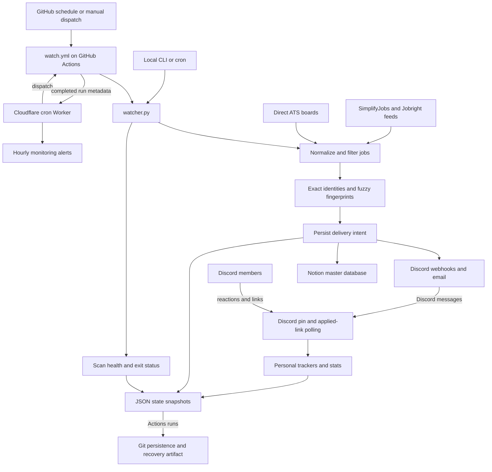

# Internship Watcher findings

**Audit base** `53c995b2c232c1f6cf6a962209858331e411e2b3` on `main`\
**Review date** November 19, 2026\
**Implementation backlog** [todo.md](todo.md)

## 1. Summary

The watcher already has useful reliability primitives. It separates observation from delivery, checkpoints intent before outbound calls, writes each JSON file atomically, and retains failed work for retry. The Notion page upsert reconciles existing links and preserves later application statuses. The main gaps are at the boundaries between those pieces. A runner can disappear before committing its local checkpoints, Discord success and its message receipt are written separately, and failed or incomplete input can look healthy. Parts of the production state also expose individual application activity through the public repository.

The first changes should contain production writes and private state, make recovery snapshots trustworthy, and stop losing accepted Discord receipts. Next, improve queue behavior and distinguish source coverage, delivery, tracker readiness, and workflow liveness. Use measured coverage and replayable fixtures before changing the identity or geographic rules.

## 2. Scope and evidence

- Five parallel reviews covered ingestion and configuration, delivery and state, Notion and Discord interactions, workflow and Worker operations, and tests and data hygiene. A separate review turned the findings into implementation stages and acceptance criteria. The findings below were consolidated against the pinned revision.
- **Observed** denotes repository code, committed state, or an offline check. **Conditional** denotes an outcome that depends on external behavior, configuration, or a failure window. **Opportunity** denotes a proposed improvement whose production payoff needs measurement. File links point to evidence at the audit base. State figures are from the committed snapshot and may differ from current production.
- Offline baseline on Python 3.12.14 with `requests==2.34.2` was **64 passing tests**. Node 24.22.3 ran **5 passing Worker tests**. CI declares Node 22 and Python 3.12 in [test.yml](https://github.com/avyukthNarra/-internship-watcher/blob/53c995b2c232c1f6cf6a962209858331e411e2b3/.github/workflows/test.yml#L17-L27). No production scan, notification, workflow dispatch, Notion write, or live permissions check was performed.
- The audit covers all tracked runtime modules and workflows, configuration, operational state shape, root and Worker documentation, and both test suites. The repository contains a Python watcher and a scheduled JavaScript Worker. Discord and Notion provide the user-facing surfaces. There is no tracked website application in this revision.

## 3. Architecture and contracts

| Layer | Responsibilities and current behavior | Entry points |
| --- | --- | --- |
| Scheduling and deployment | GitHub requests a scan every ten minutes and supports manual dispatch. A separate Cloudflare cron also dispatches `watch.yml` on `main` every ten minutes and polls completed runs. Local CLI uses the same watcher. Tests and the manual notification smoke test have their own workflows. | [watch workflow](https://github.com/avyukthNarra/-internship-watcher/blob/53c995b2c232c1f6cf6a962209858331e411e2b3/.github/workflows/watch.yml#L1-L41), [Worker](https://github.com/avyukthNarra/-internship-watcher/blob/53c995b2c232c1f6cf6a962209858331e411e2b3/internship-pinger/worker.js#L43-L86), [cron](https://github.com/avyukthNarra/-internship-watcher/blob/53c995b2c232c1f6cf6a962209858331e411e2b3/internship-pinger/wrangler.toml#L1-L7), [local CLI](https://github.com/avyukthNarra/-internship-watcher/blob/53c995b2c232c1f6cf6a962209858331e411e2b3/watcher.py#L464-L493) |
| Discovery | Up to 16 direct-board fetches run concurrently. Greenhouse, Lever, and Ashby adapt their public responses into job dicts. Enabled SimplifyJobs and Jobright feeds run after the board pool. The verifier reuses endpoint and shape validation. | [discovery](https://github.com/avyukthNarra/-internship-watcher/blob/53c995b2c232c1f6cf6a962209858331e411e2b3/watcher.py#L124-L266), [executor](https://github.com/avyukthNarra/-internship-watcher/blob/53c995b2c232c1f6cf6a962209858331e411e2b3/watcher.py#L331-L358), [feed contracts](https://github.com/avyukthNarra/-internship-watcher/blob/53c995b2c232c1f6cf6a962209858331e411e2b3/job_feeds.py#L1-L33), [verifier](https://github.com/avyukthNarra/-internship-watcher/blob/53c995b2c232c1f6cf6a962209858331e411e2b3/verify_boards.py#L19-L76) |
| Eligibility and identity | The common filter applies title, geography, and season to every adapter. The canonical URL removes a known set of campaign tags and retains meaningful query and fragment data. Source IDs and canonical ATS or URL identities are durable. Aggregates also face a company/title/location/term fingerprint check. | [filters](https://github.com/avyukthNarra/-internship-watcher/blob/53c995b2c232c1f6cf6a962209858331e411e2b3/watcher.py#L49-L119), [job identity](https://github.com/avyukthNarra/-internship-watcher/blob/53c995b2c232c1f6cf6a962209858331e411e2b3/job_utils.py#L34-L100), [selection](https://github.com/avyukthNarra/-internship-watcher/blob/53c995b2c232c1f6cf6a962209858331e411e2b3/watcher.py#L361-L383) |
| Routing and delivery | One group webhook is selected per job, with optional personal webhooks, SMTP and the Notion master database. Destination intent is recorded in the ledger before sends. Discord is bounded by attempts per run and returns message IDs for later reaction tracking. SMTP sends one message per queued job on the normal path. | [senders](https://github.com/avyukthNarra/-internship-watcher/blob/53c995b2c232c1f6cf6a962209858331e411e2b3/watcher.py#L271-L326), [routes and queue](https://github.com/avyukthNarra/-internship-watcher/blob/53c995b2c232c1f6cf6a962209858331e411e2b3/watcher.py#L386-L451), [checkpoint order](https://github.com/avyukthNarra/-internship-watcher/blob/53c995b2c232c1f6cf6a962209858331e411e2b3/watcher.py#L495-L520) |
| Application tracking | Discord uses REST polling. A 📌 on a mapped notification queues a Saved row. Links posted in the applied channel queue Applied rows, optional follow-ups and a reaction acknowledgment. A daily sweep checks Saved rows for closures. The hub callout derives counts from Notion statuses, which members can update manually. | [Discord polling](https://github.com/avyukthNarra/-internship-watcher/blob/53c995b2c232c1f6cf6a962209858331e411e2b3/notion_sync.py#L158-L262), [queue and status](https://github.com/avyukthNarra/-internship-watcher/blob/53c995b2c232c1f6cf6a962209858331e411e2b3/notion_sync.py#L539-L684), [sweep and stats](https://github.com/avyukthNarra/-internship-watcher/blob/53c995b2c232c1f6cf6a962209858331e411e2b3/notion_sync.py#L701-L898) |
| Health and recovery | Health tracks completed scans, per-source failure age, pending destinations and tracker sync errors. Exit status treats any remaining deliveries or sync error as failure and tolerates a source outage for five hours. GitHub commits JSON after the watcher step and uploads an artifact. The Worker observes GitHub run metadata and sends warnings on an hourly gate. | [health](https://github.com/avyukthNarra/-internship-watcher/blob/53c995b2c232c1f6cf6a962209858331e411e2b3/source_health.py#L3-L47), [workflow persistence](https://github.com/avyukthNarra/-internship-watcher/blob/53c995b2c232c1f6cf6a962209858331e411e2b3/.github/workflows/watch.yml#L43-L73), [monitor](https://github.com/avyukthNarra/-internship-watcher/blob/53c995b2c232c1f6cf6a962209858331e411e2b3/internship-pinger/worker.js#L113-L154) |

### Data ownership and recovery state

| File | What it owns today | Shape and measured size |
| --- | --- | --- |
| `config.json` | Company boards, filter defaults, feeds, route preferences and follow-up durations. Credentials come from the environment. | 172 direct board entries. Terms are Fall 2026, Winter 2027, Spring 2027 and Summer 2027. Profiles are configurable. [Configuration validation](https://github.com/avyukthNarra/-internship-watcher/blob/53c995b2c232c1f6cf6a962209858331e411e2b3/project_config.py#L32-L97) |
| `seen.json` | Compatibility history of observed source IDs. | 20,596 entries and 896,202 bytes. Its ID set matches the ledger copy. [Read and write sequence](https://github.com/avyukthNarra/-internship-watcher/blob/53c995b2c232c1f6cf6a962209858331e411e2b3/watcher.py#L474-L501) |
| `delivery_state.json` | Authoritative ID fallback after a local partial checkpoint, exact identity map, timestamped fingerprints, and pending jobs with destination lists. | 2,243,743 bytes, 20,596 known IDs, 10,009 identities, 3,550 fingerprints and no pending entries in the audited snapshot. [Selection and queue](https://github.com/avyukthNarra/-internship-watcher/blob/53c995b2c232c1f6cf6a962209858331e411e2b3/watcher.py#L361-L451) |
| `message_map.json` | Discord message and channel IDs, timestamp, and job data used for pin lookup. | 114,960 bytes, 311 entries in two channels. The watcher prunes mappings after three days. [Receipt recording](https://github.com/avyukthNarra/-internship-watcher/blob/53c995b2c232c1f6cf6a962209858331e411e2b3/watcher.py#L419-L423), [pruning](https://github.com/avyukthNarra/-internship-watcher/blob/53c995b2c232c1f6cf6a962209858331e411e2b3/watcher.py#L502-L504) |
| `notion_state.json` | Master and user tracker IDs, page associations, applied cursor, saved and applied history, pending tracker work and stats block ID. | 9,960 bytes, one tracker, 84 tracked job IDs and 34 application URLs. Both tracker queues were empty. Counts only are included here. [Tracker state writes](https://github.com/avyukthNarra/-internship-watcher/blob/53c995b2c232c1f6cf6a962209858331e411e2b3/notion_sync.py#L572-L684) |
| `health.json` | Most recently reported source and pipeline health, written after delivery and tracker work. | 21,660 bytes. 172 healthy sources, three stale board failures, 632 matching jobs, zero new and zero pending destinations. [Health model](https://github.com/avyukthNarra/-internship-watcher/blob/53c995b2c232c1f6cf6a962209858331e411e2b3/source_health.py#L6-L28), [checkpoint and exit](https://github.com/avyukthNarra/-internship-watcher/blob/53c995b2c232c1f6cf6a962209858331e411e2b3/watcher.py#L454-L520) |

A normal scan creates a source-side ID, computes canonical identity, and makes an eligibility decision before queueing. Queued delivery survives a normal failed run when the runner can publish its state. Accepted Discord messages enable the pin path through their receipts. Applied links enter independently of job discovery. Notion then applies status updates to canonical matches inside the relevant tracker. The files are per-file atomic and have no shared snapshot generation.

## 4. Production operations and recovery

### OPS-01

**High · Observed configuration, conditional production impact · Fence manual runs to the right ref and environment.** GitHub lets an operator select a branch for manual dispatch. The workflow checks out the selected ref, exposes production credentials in the watcher step, and later rebases and pushes `HEAD:main`. A non-main run can therefore produce real notifications and attempt to publish code commits to main if repository policy permits it. The manual Test Ping also has no ref or environment guard. Scope production runs explicitly and make state publication unable to carry application commits. Default checkout follows the triggering revision and a rerun reuses its original revision, so a serialized run may also start against stale checkpoints. Read current operational state under the writer boundary before sending. [Watcher workflow](https://github.com/avyukthNarra/-internship-watcher/blob/53c995b2c232c1f6cf6a962209858331e411e2b3/.github/workflows/watch.yml#L3-L54) · [Test Ping](https://github.com/avyukthNarra/-internship-watcher/blob/53c995b2c232c1f6cf6a962209858331e411e2b3/.github/workflows/test-ping.yml#L5-L18) · [GitHub dispatch documentation](https://docs.github.com/en/actions/how-tos/manage-workflow-runs/manually-run-a-workflow) · [rerun revision behavior](https://docs.github.com/en/actions/how-tos/manage-workflow-runs/re-run-workflows-and-jobs)

### OPS-02

**High · Observed design, conditional recovery failure · Capture coherent recovery data before Git mutations.** The only local checkpoints live on the Actions runner until persistence. A hard timeout or runner loss can strand accepted effects and queue updates despite `always()`. A failed rebase exits at the first conflict and the subsequent artifact reads the modified working tree. An isolated rebase with synthetic state confirmed that conflict markers can be left in JSON. Reruns share an artifact name based solely on run ID. Independently validate and stage an immutable snapshot with run attempt, generation, checksums and all required records, then exercise restoration. The next durability step is a private store that survives runner loss at checkpoint time. [Persistence and artifact](https://github.com/avyukthNarra/-internship-watcher/blob/53c995b2c232c1f6cf6a962209858331e411e2b3/.github/workflows/watch.yml#L43-L73) · [local checkpoint](https://github.com/avyukthNarra/-internship-watcher/blob/53c995b2c232c1f6cf6a962209858331e411e2b3/watcher.py#L495-L520) · [artifact names and immutability](https://github.com/actions/upload-artifact)

### OPS-03

**Medium · Observed · Live state consumes code history and write time.** The five committed snapshots total 3,286,525 bytes. The audited Git history had 12,603 commits, and the latest 200 commit subjects were automated state updates. The full clone had a roughly 49.7 MiB pack, including code history. A whole sorted ledger rewrite occurs after every attempted delivery. With the snapshot's ledger, 50 attempts imply roughly 107 MiB of ledger payload serialization before file reads, other state writes, or Git. An isolated 50-write replay took about 0.83 seconds locally using real snapshot cardinality. GitHub runner timings and end-to-end cost were outside the measurement. An access-controlled state service or database can reduce churn and support atomic intent and receipt commits. A private snapshot store is a smaller ownership change if it can meet the recovery objective. [Atomic writer](https://github.com/avyukthNarra/-internship-watcher/blob/53c995b2c232c1f6cf6a962209858331e411e2b3/job_utils.py#L19-L31) · [per-attempt checkpoint](https://github.com/avyukthNarra/-internship-watcher/blob/53c995b2c232c1f6cf6a962209858331e411e2b3/watcher.py#L406-L439) · [Git commits](https://github.com/avyukthNarra/-internship-watcher/blob/53c995b2c232c1f6cf6a962209858331e411e2b3/.github/workflows/watch.yml#L43-L59)

### OPS-04

**Medium · Observed configuration, conditional overlap · Make scan cadence deliberate.** Both schedulers request scans on the same ten-minute grid. GitHub's default concurrency group permits one running and one pending run, and a newer pending run can replace its predecessor even with `cancel-in-progress: false`. This protects the single writer in ordinary Actions scheduling, but can waste runs and make workflow conclusions harder to interpret. Neither schedule establishes a latency guarantee. Choose a primary cadence and define a stale-gated backup if redundancy is valuable. Measure dispatch-to-start, scan duration, source freshness and delivery lag before setting targets. [Workflow scheduling](https://github.com/avyukthNarra/-internship-watcher/blob/53c995b2c232c1f6cf6a962209858331e411e2b3/.github/workflows/watch.yml#L3-L18) · [Worker schedule](https://github.com/avyukthNarra/-internship-watcher/blob/53c995b2c232c1f6cf6a962209858331e411e2b3/internship-pinger/wrangler.toml#L1-L7) · [GitHub concurrency](https://docs.github.com/en/actions/concepts/workflows-and-actions/concurrency) · [schedule delays](https://docs.github.com/en/actions/how-tos/troubleshoot-workflows) · [Cloudflare cron](https://developers.cloudflare.com/workers/configuration/cron-triggers/)

### OPS-05

**Medium · Observed · Worker alerting conflates different operational failures.** The Worker inspects ten completed runs and counts any non-success conclusion as a failure streak. In offline checks a JSON null response threw, and a successful run without a timestamp appeared healthy. It checks success age only when the first returned run succeeded, and cannot show whether a live run is making progress, whether an old success is stale during a failure streak, or why the application failed. Alert dispatch failures are logged, but their return values do not affect the handler outcome. Hourly gating shares no state across duplicate cron delivery and gives a failed alert no retry before the next hourly opportunity. Split dispatch, workflow freshness, application health and alert delivery into separate signals. [Run lookup and failure streak](https://github.com/avyukthNarra/-internship-watcher/blob/53c995b2c232c1f6cf6a962209858331e411e2b3/internship-pinger/worker.js#L14-L64) · [alert path](https://github.com/avyukthNarra/-internship-watcher/blob/53c995b2c232c1f6cf6a962209858331e411e2b3/internship-pinger/worker.js#L90-L154) · [GitHub workflows REST API](https://docs.github.com/en/rest/actions/workflows)

### OPS-06

**Medium · Observed · A warm backlog and stale feed present as the same red workflow.** The workflow exit code fails on a single source down for five hours, any remaining delivery, or a sync error. A large but healthy queue deferred by the intentional cap looks like a delivery outage. A wholly unavailable source fleet can still report success during the five-hour grace period if no work is pending. A stage error before health reporting leaves a previous health file with no indication of the new attempt. Its last completed scan timestamp is captured before delivery and sync. Separate scan attempt, completed scan, coverage degradation, delivery progress and tracker status. [Health thresholds](https://github.com/avyukthNarra/-internship-watcher/blob/53c995b2c232c1f6cf6a962209858331e411e2b3/source_health.py#L6-L47) · [stage order](https://github.com/avyukthNarra/-internship-watcher/blob/53c995b2c232c1f6cf6a962209858331e411e2b3/watcher.py#L464-L520)

## 5. Data privacy and operational boundaries

### SAFE-01

**High · Observed · Operational state exposes personal application activity.** The public Git repository stores Discord account IDs and display names, lists of applied URLs, and associations with Notion trackers and pages. The webhook message map also exposes Discord channel and message IDs. The workflow stages these files and includes them in downloadable recovery artifacts. These fields can be sensitive without being credentials. Move writable state and full recovery snapshots to private storage, publish only carefully scoped aggregate health, and have the repository owner decide how to handle historical exposure and tracker sharing. A separate public state branch preserves exposure. [Collection](https://github.com/avyukthNarra/-internship-watcher/blob/53c995b2c232c1f6cf6a962209858331e411e2b3/notion_sync.py#L583-L641) · [pins](https://github.com/avyukthNarra/-internship-watcher/blob/53c995b2c232c1f6cf6a962209858331e411e2b3/notion_sync.py#L659-L684) · [message mapping](https://github.com/avyukthNarra/-internship-watcher/blob/53c995b2c232c1f6cf6a962209858331e411e2b3/watcher.py#L421-L423) · [workflow](https://github.com/avyukthNarra/-internship-watcher/blob/53c995b2c232c1f6cf6a962209858331e411e2b3/.github/workflows/watch.yml#L43-L73) · [artifact access](https://docs.github.com/en/actions/how-tos/manage-workflow-runs/download-workflow-artifacts)

### SAFE-02

**High · Observed boundary, conditional impact · Bound outbound fetches from Applied links.** A channel-authored URL goes to the runner's generic HTTP fetch with default redirects and an unbounded body read. The parser performs that HTML fetch before trying ATS metadata. Establish a policy for allowed public destinations, validate redirected destinations, cap bytes and wall time, and retain a metadata-free filing path for unsupported links. Use supported ATS metadata first. Raw upstream response bodies and internal resource paths also surface in selected sync warnings, so keep detailed diagnostics in appropriately protected logs. No active network probing was performed for this finding. [Applied input](https://github.com/avyukthNarra/-internship-watcher/blob/53c995b2c232c1f6cf6a962209858331e411e2b3/notion_sync.py#L595-L633) · [URL fetch](https://github.com/avyukthNarra/-internship-watcher/blob/53c995b2c232c1f6cf6a962209858331e411e2b3/notion_sync.py#L444-L468) · [warning examples](https://github.com/avyukthNarra/-internship-watcher/blob/53c995b2c232c1f6cf6a962209858331e411e2b3/notion_sync.py#L109-L114) · [Discord warnings](https://github.com/avyukthNarra/-internship-watcher/blob/53c995b2c232c1f6cf6a962209858331e411e2b3/notion_sync.py#L219-L225)

### SAFE-03

**High if SMTP is enabled · Observed in audited runtime · Verify SMTP peer identity before login.** The SMTP adapter calls `starttls()` without an explicit context. On the audited CPython runtime the implicit stdlib context did not verify peer certificates or hostnames. Pass a verified default context, check the configured provider's TLS behavior in an approved setup, and add unit coverage for validation before authentication. [SMTP adapter](https://github.com/avyukthNarra/-internship-watcher/blob/53c995b2c232c1f6cf6a962209858331e411e2b3/watcher.py#L305-L326) · [Python SMTP documentation](https://docs.python.org/3.12/library/smtplib.html) · [Python TLS documentation](https://docs.python.org/3.12/library/ssl.html)

### SAFE-04

**Medium · Observed controls, conditional configuration gaps · Treat production credentials and routing as a validated manifest.** The project correctly uses secrets and suppresses Discord job mentions. Personal mappings accept any key starting with `DISCORD_WEBHOOK_`, including reserved group names, and `setdefault` means an explicitly present blank environment variable shadows a fallback value. Partial optional credentials silently disable integrations. When every destination is unavailable, the current CLI automatically previews, skips health reporting and exits zero. That is useful locally but can falsely report a production run as green. The Worker has a separate GitHub token and alert webhook, and the production workflow has write permission for its full job. Validate the route map, make disabled and misconfigured states visible without exposing values, scope write credentials to the step or deployment boundary that needs them, and use a repository-scoped Actions token for the Worker. [Config import and feature detection](https://github.com/avyukthNarra/-internship-watcher/blob/53c995b2c232c1f6cf6a962209858331e411e2b3/project_config.py#L57-L92) · [workflow secrets](https://github.com/avyukthNarra/-internship-watcher/blob/53c995b2c232c1f6cf6a962209858331e411e2b3/.github/workflows/watch.yml#L8-L41) · [Worker headers](https://github.com/avyukthNarra/-internship-watcher/blob/53c995b2c232c1f6cf6a962209858331e411e2b3/internship-pinger/worker.js#L6-L11) · [Discord post payload](https://github.com/avyukthNarra/-internship-watcher/blob/53c995b2c232c1f6cf6a962209858331e411e2b3/watcher.py#L281-L286)

## 6. Ingestion, filtering and identity

### ING-01

**High · Observed · Health reports JSON success before adapters validate records.** A decoded 200 marks a source successful before shape checking and normalization. Shape validation rejects a whole list for one invalid row identity, while inconsistent nested/title types can create a second synthetic health key or escape the shared filter and stop the scan. Jobright can report a blank body as healthy, and the zero-match error can retain a freshly recorded last-success timestamp. The verifier validates less than the watcher consumes. Use one stable source ID, validate an envelope and normalize rows into a shared job contract, keep usable neighbors, and explicitly report malformed-row counts and partial sources. [Shared shapes](https://github.com/avyukthNarra/-internship-watcher/blob/53c995b2c232c1f6cf6a962209858331e411e2b3/job_feeds.py#L19-L33) · [fetch and direct adapters](https://github.com/avyukthNarra/-internship-watcher/blob/53c995b2c232c1f6cf6a962209858331e411e2b3/watcher.py#L61-L175) · [Jobright](https://github.com/avyukthNarra/-internship-watcher/blob/53c995b2c232c1f6cf6a962209858331e411e2b3/watcher.py#L222-L266) · [discovery](https://github.com/avyukthNarra/-internship-watcher/blob/53c995b2c232c1f6cf6a962209858331e411e2b3/watcher.py#L331-L358) · [verifier](https://github.com/avyukthNarra/-internship-watcher/blob/53c995b2c232c1f6cf6a962209858331e411e2b3/verify_boards.py#L19-L33)

### ING-02

**High for affected companies · Observed snapshot, live status unverified · Three direct boards are stale and freshness is unmeasured.** In the committed health snapshot, the configured Browserbase Ashby, Mistral Lever and Old Mission Capital Greenhouse boards had persistent 404s. The 172 direct boards break down to 95 Greenhouse, 71 Ashby and six Lever, with three additional aggregate sources. All aggregates were recorded healthy, although their successful fetch says little about calendar freshness. Tracked 404 durations were about 61.5 hours for Browserbase, 355.2 for Mistral and 702.7 for Old Mission Capital. Simplify defaults to a year-named older repository while the active terms include Summer 2027. The old repository page redirects to the Summer 2027 repository. Confirm the effective raw URL, upstream recency and overlap before changing it. Postman relies on aggregates since its move to Workday. Measure the gap before prioritizing a direct Workday adapter. [Snapshot totals](https://github.com/avyukthNarra/-internship-watcher/blob/53c995b2c232c1f6cf6a962209858331e411e2b3/health.json#L2-L6) · [Browserbase](https://github.com/avyukthNarra/-internship-watcher/blob/53c995b2c232c1f6cf6a962209858331e411e2b3/health.json#L48-L53) · [Mistral](https://github.com/avyukthNarra/-internship-watcher/blob/53c995b2c232c1f6cf6a962209858331e411e2b3/health.json#L294-L299) · [Old Mission Capital](https://github.com/avyukthNarra/-internship-watcher/blob/53c995b2c232c1f6cf6a962209858331e411e2b3/health.json#L556-L561) · [Source totals](https://github.com/avyukthNarra/-internship-watcher/blob/53c995b2c232c1f6cf6a962209858331e411e2b3/health.json#L715-L717) · [State schema](https://github.com/avyukthNarra/-internship-watcher/blob/53c995b2c232c1f6cf6a962209858331e411e2b3/source_health.py#L6-L28) · [Simplify source default](https://github.com/avyukthNarra/-internship-watcher/blob/53c995b2c232c1f6cf6a962209858331e411e2b3/watcher.py#L38-L41) · [feed windows](https://github.com/avyukthNarra/-internship-watcher/blob/53c995b2c232c1f6cf6a962209858331e411e2b3/watcher.py#L185-L266) · [existing coverage notes](https://github.com/avyukthNarra/-internship-watcher/blob/53c995b2c232c1f6cf6a962209858331e411e2b3/README.md#L80-L84) · [SimplifyJobs Summer 2027](https://github.com/SimplifyJobs/Summer2027-Internships)

### ING-03

**Medium · Observed · Jobright depends on a narrow Markdown layout and guessed dates.** A single regex expects bold links, fixed column order, a hex ID, continuation rows and month/day dates. A continuation can inherit a preceding company's name after an unrecognized row. Invalid dates still count toward parser success, and the implicit year rollover has leap-year edge cases. Normalize parse outcomes, preserve contextual information only within the current table/group, and keep dated fixtures for format variation, blank feeds and rollover. [Jobright regex and parser](https://github.com/avyukthNarra/-internship-watcher/blob/53c995b2c232c1f6cf6a962209858331e411e2b3/watcher.py#L215-L266)

### ING-04

**Medium · Observed implementation, opportunity to improve recall · Keep structured location and term information.** The title gate is substring-based, geography is a denylist with a US hint override, unknown locations stay eligible, and Simplify retains only its first three locations. Ashby can supply secondary locations and an `isListed` flag, but the adapter only reads its primary location and does not apply that flag. Explicit feed term handling and desired term whitespace/spelling are asymmetric, and many variants remain unknown. Preserve provider metadata and use annotated examples to evaluate filter changes before rollout, including non-US locations, ambiguous abbreviations, co-ops, internationalization and season formatting. [Title and location rules](https://github.com/avyukthNarra/-internship-watcher/blob/53c995b2c232c1f6cf6a962209858331e411e2b3/watcher.py#L49-L119) · [Ashby and Simplify adapters](https://github.com/avyukthNarra/-internship-watcher/blob/53c995b2c232c1f6cf6a962209858331e411e2b3/watcher.py#L164-L211) · [season normalization](https://github.com/avyukthNarra/-internship-watcher/blob/53c995b2c232c1f6cf6a962209858331e411e2b3/job_utils.py#L63-L81) · [Ashby schema](https://developers.ashbyhq.com/docs/public-job-posting-api)

### ING-05

**Medium · Observed · Weak dedup decisions can suppress a distinct requisition permanently.** An aggregate row with a different ID and URL is suppressed if the fingerprint matches earlier work, then its exact ID and identity are still marked known. Conversely, an aggregate-first job followed by a direct posting with a different identity can alert twice. Expired fingerprints can be seeded again from still-visible exact IDs. These cases were checked offline. Record whether an identity was observed, alerted or only weakly matched. Prefer trusted native requisition IDs, keep source aliases and provenance, and make fuzzy decisions reversible and measurable. [Fingerprint fields](https://github.com/avyukthNarra/-internship-watcher/blob/53c995b2c232c1f6cf6a962209858331e411e2b3/job_utils.py#L84-L88) · [selection](https://github.com/avyukthNarra/-internship-watcher/blob/53c995b2c232c1f6cf6a962209858331e411e2b3/watcher.py#L361-L383)

### ING-06

**Medium · Observed contract gaps · Require reliable identifiers and links at adapter boundaries.** Some adapters can emit missing URLs or weak derived IDs, and `job_identity` recognizes `gh_jid` without using the source's board metadata as corroboration. A canonical URL handles tracking variants well, but provider-specific aliases, malformed values, duplicate query keys or alternate host conventions need regression fixtures. Declare what makes a job actionable, retain native source IDs separately from cross-source keys, and make identity migration compatible with existing state. Verify Greenhouse, Lever and Ashby fields against official contracts and recorded examples. [Shape validation](https://github.com/avyukthNarra/-internship-watcher/blob/53c995b2c232c1f6cf6a962209858331e411e2b3/job_feeds.py#L19-L33) · [native adapter fields](https://github.com/avyukthNarra/-internship-watcher/blob/53c995b2c232c1f6cf6a962209858331e411e2b3/watcher.py#L136-L175) · [URL and ATS ID](https://github.com/avyukthNarra/-internship-watcher/blob/53c995b2c232c1f6cf6a962209858331e411e2b3/job_utils.py#L34-L60) · [Greenhouse](https://docs.greenhouse.io/job-board.html) · [Lever](https://github.com/lever/postings-api) · [Ashby](https://developers.ashbyhq.com/docs/public-job-posting-api)

### ING-07

**Low to medium · Opportunity · Budget source traffic by provider and measure before optimizing.** Direct fetches use top-level `requests.get` with no explicit persistent connection pool, back off uniformly on retry and follow fixed worker width. Aggregate requests run later, with Jobright repos fetched sequentially. Add latency, payload, retry and rate-limit measurements first. Consider reusable per-thread sessions, rate-aware jitter, conditional requests where supported, and bounded parallel aggregate fetches only if measurement supports it. Keep result ordering deterministic because selection currently depends on it. [Fetch policy](https://github.com/avyukthNarra/-internship-watcher/blob/53c995b2c232c1f6cf6a962209858331e411e2b3/watcher.py#L43-L79) · [Jobright loop](https://github.com/avyukthNarra/-internship-watcher/blob/53c995b2c232c1f6cf6a962209858331e411e2b3/watcher.py#L222-L237) · [execution order](https://github.com/avyukthNarra/-internship-watcher/blob/53c995b2c232c1f6cf6a962209858331e411e2b3/watcher.py#L331-L358)

### ING-08

**Medium · Observed · Configuration validation stops short of operational validation.** Typed options and whole-secret pre-validation are useful. Duplicate boards, invalid URL or repo forms, empty keyword entries, zero Discord budget with Discord enabled, and SMTP connection settings can still lead to confusing behavior. Normalization also differs between Simplify's company filtering and the top-route test. Add an offline validation command with actionable field paths and checks for board uniqueness, filter semantics, route availability and deployment-specific versions. Preserve documented zero follow-up days. [Config validation](https://github.com/avyukthNarra/-internship-watcher/blob/53c995b2c232c1f6cf6a962209858331e411e2b3/project_config.py#L13-L69) · [Simplify filtering](https://github.com/avyukthNarra/-internship-watcher/blob/53c995b2c232c1f6cf6a962209858331e411e2b3/watcher.py#L185-L201) · [top routing and budget](https://github.com/avyukthNarra/-internship-watcher/blob/53c995b2c232c1f6cf6a962209858331e411e2b3/watcher.py#L386-L418)

## 7. Delivery semantics and throughput

### DEL-01

**High · Confirmed offline · Discord delivery can acknowledge before the pin receipt persists.** The caller sets success before writing the Discord message map. A caught write error then falls through the success branch, removes the destination and clears the error. A mocked disk failure left no durable receipt or replayable destination for a webhook that had accepted the job. Persist the returned receipt as delivery state, repair the map from that receipt, and only then complete mapping. A lost provider response remains ambiguous even with this fix. [Discord response](https://github.com/avyukthNarra/-internship-watcher/blob/53c995b2c232c1f6cf6a962209858331e411e2b3/watcher.py#L281-L298) · [receipt/checkpoint](https://github.com/avyukthNarra/-internship-watcher/blob/53c995b2c232c1f6cf6a962209858331e411e2b3/watcher.py#L406-L439)

### DEL-02

**High · Confirmed ordering problem, conditional backlog impact · Retry work can starve healthy routes.** The serializer sorts keys and the delivery loop follows that order after restart. Repeatedly failing early keys can spend the shared Discord budget ahead of healthy work. A single job-wide error can be cleared by success on a different route. Skipped destinations with missing secrets have no diagnostic or lifecycle, and permanent failures can stay pending indefinitely. Give each destination retry state, target label, reason, next eligibility, fair ordering, and an operator-visible way to retry or retire quarantined items. [JSON sort](https://github.com/avyukthNarra/-internship-watcher/blob/53c995b2c232c1f6cf6a962209858331e411e2b3/job_utils.py#L19-L31) · [delivery loop](https://github.com/avyukthNarra/-internship-watcher/blob/53c995b2c232c1f6cf6a962209858331e411e2b3/watcher.py#L406-L439)

### DEL-03

**High · Observed unbounded stages, conditional runtime impact · Budget time in addition to Discord attempts.** A single Discord budget unit can make three requests and sleep twice. Fifty units with two capped 30-second backoffs each already exceed the 30-minute Actions job budget before counting network or other stages. SMTP, Notion and interaction delivery have no comparable count cap. Discord 429 handling can clip a requested delay, and the standard fallback backoff ignores the body delay. Persist eligibility for the next run, reserve recovery time, and show queue age and progress separately from failures. Add per-stage limits and a soft deadline, using provider-compatible delay semantics. [Discord retries](https://github.com/avyukthNarra/-internship-watcher/blob/53c995b2c232c1f6cf6a962209858331e411e2b3/watcher.py#L271-L302) · [delivery loop](https://github.com/avyukthNarra/-internship-watcher/blob/53c995b2c232c1f6cf6a962209858331e411e2b3/watcher.py#L406-L439) · [Actions timeout](https://github.com/avyukthNarra/-internship-watcher/blob/53c995b2c232c1f6cf6a962209858331e411e2b3/.github/workflows/watch.yml#L15-L18) · [Discord rate limits](https://docs.discord.com/developers/topics/rate-limits)

### DEL-04

**Medium · Confirmed offline · Observed and routed jobs share terminal identity state.** A top-only configuration can observe general jobs with no destinations. Personal-only configurations similarly observe jobs that match no profile. These jobs still become known, so adding a destination later does not backfill them. That may be desirable for some routes. Make the contract explicit and provide bounded, dry-runnable replay with per-route acknowledgment rules when it is wanted. [selection and routing](https://github.com/avyukthNarra/-internship-watcher/blob/53c995b2c232c1f6cf6a962209858331e411e2b3/watcher.py#L361-L403) · [enqueue and known IDs](https://github.com/avyukthNarra/-internship-watcher/blob/53c995b2c232c1f6cf6a962209858331e411e2b3/watcher.py#L442-L451)

### DEL-05

**Medium · Confirmed offline · Discord rendering can exceed provider limits after fallback.** The length fallback truncates the company and title but keeps an unbounded URL and discards the pin instruction. Feed-provided Markdown can also alter formatting. The core path already disables mentions. Bound the final rendered payload, preserve the pin affordance when meaningful, and define an explicit long-link fallback that keeps usable URLs. [Renderer](https://github.com/avyukthNarra/-internship-watcher/blob/53c995b2c232c1f6cf6a962209858331e411e2b3/watcher.py#L271-L301) · [Discord webhook constraints](https://docs.discord.com/developers/resources/webhook#execute-webhook)

### DEL-06

**Medium · Observed transport, conditional duplicate risk · Treat accepted SMTP DATA as a distinct outcome.** The email adapter opens one connection per job. An exception during teardown after accepted DATA can leave the item pending and prompt a resend. Reuse a bounded session where appropriate, checkpoint an acknowledged outcome without depending on clean shutdown, and keep uncertainty explicit when the acknowledgment was never received. Neither SMTP nor ordinary Discord webhooks provide a proven exactly-once contract here. [SMTP request](https://github.com/avyukthNarra/-internship-watcher/blob/53c995b2c232c1f6cf6a962209858331e411e2b3/watcher.py#L305-L326) · [one job per delivery](https://github.com/avyukthNarra/-internship-watcher/blob/53c995b2c232c1f6cf6a962209858331e411e2b3/watcher.py#L424-L437)

## 8. Discord intake and Notion trackers

### TRK-01

**High · Confirmed offline · A bad Applied link can block later valid inputs.** Canonicalization happens while collecting a whole page, before the page cursor is saved. A malformed URL can raise and make every subsequent run revisit the same bad page. The applied cursor is global and queued records omit channel provenance, so channel reconfiguration can also skip history or misroute acknowledgment. Missing Message Content access can resemble an empty submission. Isolate rejected input per message, retain origin and cursor per channel, and make bootstrap, permissions and replay explicit. [URL pipe](https://github.com/avyukthNarra/-internship-watcher/blob/53c995b2c232c1f6cf6a962209858331e411e2b3/job_utils.py#L34-L42) · [Discord content expectations](https://github.com/avyukthNarra/-internship-watcher/blob/53c995b2c232c1f6cf6a962209858331e411e2b3/notion_sync.py#L204-L230) · [collector and delivery](https://github.com/avyukthNarra/-internship-watcher/blob/53c995b2c232c1f6cf6a962209858331e411e2b3/notion_sync.py#L595-L656)

### TRK-02

**Medium · Observed limits, conditional backlog gaps · Make Discord collection and acknowledgments loss-aware.** Tracked message mappings are pruned after three days, before reaction collection. User-facing copy gives no expiry. A pin reactor query fetches a single page of up to 100 normal reactions. Both message loops advance to a batch's largest ID. Discord documents newest-to-oldest results but does not establish that the selected slice after a lower bound covers the oldest unread entries when the backlog is larger than one page. Use an explicitly bounded pagination strategy and test gaps, live arrivals and durable watermarks. Applied success acknowledgment is best effort after the queue record is removed, so a crash, missing bot config or transient failure can leave a successfully filed row without a visible check. Decide whether to make acknowledgments durable independently of the Notion write. [Mapping retention](https://github.com/avyukthNarra/-internship-watcher/blob/53c995b2c232c1f6cf6a962209858331e411e2b3/watcher.py#L502-L504) · [reactions and history](https://github.com/avyukthNarra/-internship-watcher/blob/53c995b2c232c1f6cf6a962209858331e411e2b3/notion_sync.py#L158-L262) · [Applied queues](https://github.com/avyukthNarra/-internship-watcher/blob/53c995b2c232c1f6cf6a962209858331e411e2b3/notion_sync.py#L595-L656) · [Discord messages and reactions](https://docs.discord.com/developers/resources/message)

### TRK-03

**High · Confirmed offline · Bootstrap and append can create duplicate resources.** Ambiguous page creates defer retry and invalidate the lookup cache, which is useful. Database bootstrap for the master log and trackers retries later when there is no saved ID, without checking for an already-created database. Stats uses an append PATCH, which the generic transport can retry even after an ambiguous response. A stale schema marker or missing stats block also needs typed recovery. Record resource intent and stable identity before writes, reconcile after uncertain outcomes, and distinguish deletion from missing permission before replacing an existing resource. [Transport](https://github.com/avyukthNarra/-internship-watcher/blob/53c995b2c232c1f6cf6a962209858331e411e2b3/notion_sync.py#L78-L116) · [bootstrap and row upserts](https://github.com/avyukthNarra/-internship-watcher/blob/53c995b2c232c1f6cf6a962209858331e411e2b3/notion_sync.py#L522-L580) · [stats resource lifecycle](https://github.com/avyukthNarra/-internship-watcher/blob/53c995b2c232c1f6cf6a962209858331e411e2b3/notion_sync.py#L840-L872)

### TRK-04

**High for affected trackers · Confirmed offline · Closure checks can mark valid postings Closed.** An Ashby decoded 200 without a valid jobs list can be interpreted as an absent job. Lever EU links are checked through the global endpoint. The Greenhouse and Lever detail checks classify a 404 as closure without checking whether the board itself moved. The sweep reads Saved rows then writes Closed later, which can race a manual status update. Keep unknown liveness distinct from closure, use provider-aware routing and validated evidence, and consider putting liveness in a separate field from the manually owned pipeline status. [Liveness provider checks](https://github.com/avyukthNarra/-internship-watcher/blob/53c995b2c232c1f6cf6a962209858331e411e2b3/notion_sync.py#L701-L738) · [sweep writes](https://github.com/avyukthNarra/-internship-watcher/blob/53c995b2c232c1f6cf6a962209858331e411e2b3/notion_sync.py#L741-L786) · [Lever regional endpoints](https://github.com/lever/postings-api)

### TRK-05

**Medium · Observed · Application dates and follow-up behavior need a product contract.** The current application date defaults to the UTC date that sync processes the link. A backlog can shift it. A new Applied row is created before dates are written, and an existing Applied row with an application date may keep a missing follow-up value. The due display only includes Applied rows and appears in the hub callout. Define the source timestamp, timezone, manual override handling and stage eligibility. Preserve date edits and later statuses. [Row creation](https://github.com/avyukthNarra/-internship-watcher/blob/53c995b2c232c1f6cf6a962209858331e411e2b3/notion_sync.py#L140-L153) · [date updates](https://github.com/avyukthNarra/-internship-watcher/blob/53c995b2c232c1f6cf6a962209858331e411e2b3/notion_sync.py#L539-L569) · [due calculation](https://github.com/avyukthNarra/-internship-watcher/blob/53c995b2c232c1f6cf6a962209858331e411e2b3/notion_sync.py#L807-L837)

### TRK-06

**Medium · Observed cost pattern · Full scans and stats updates grow with tracked history.** Notion page lookup reads the full paginated database and linearly recomputes identities for each upsert. The cache reduces repeated fetching within an invocation, but the sync clears it before stats and rewrites a timestamped callout each run. A failed tracker read can replace complete stats with a partial summary, and truncation can omit the end of the roster. Use a validated identity lookup with a legacy fallback, record per-database request cost, publish freshness or completeness, and update stats on a deliberate cadence. Review whether the shared hub should expose named counts and due role names. [Database reads and upsert](https://github.com/avyukthNarra/-internship-watcher/blob/53c995b2c232c1f6cf6a962209858331e411e2b3/notion_sync.py#L506-L569) · [stats summary](https://github.com/avyukthNarra/-internship-watcher/blob/53c995b2c232c1f6cf6a962209858331e411e2b3/notion_sync.py#L795-L872) · [cache lifecycle](https://github.com/avyukthNarra/-internship-watcher/blob/53c995b2c232c1f6cf6a962209858331e411e2b3/notion_sync.py#L877-L898)

### TRK-07

**Medium · Observed version, conditional compatibility risk · Plan a Notion data-source migration.** The client pins the 2022-06-28 API and uses database-level query and schema APIs. Notion's data-source migration guide documents failure cases for older clients when a database gains multiple data sources. Single-source deployments can continue to work. Inventory actual databases before upgrading, add a versioned adapter for database and data-source IDs, and prove that existing page IDs, aliases and manual statuses survive the upgrade. [Version and creation](https://github.com/avyukthNarra/-internship-watcher/blob/53c995b2c232c1f6cf6a962209858331e411e2b3/notion_sync.py#L70-L153) · [query and schema](https://github.com/avyukthNarra/-internship-watcher/blob/53c995b2c232c1f6cf6a962209858331e411e2b3/notion_sync.py#L506-L536) · [Notion upgrade guide](https://developers.notion.com/guides/get-started/upgrade-guide-2025-09-03) · [Notion request limits](https://developers.notion.com/reference/request-limits)

## 9. Verification, release and maintainability

### QA-01

**Medium · Observed · Existing tests cover important recovery but stop short of several real boundaries.** The Python suite covers shared filters, verifier behavior, route independence, status preservation, queue replay and recovery from simulated failures. The Worker tests cover failure streak, stale success and hourly gating. Existing pipeline tests patch outbound services and run on temporary state. Add targeted boundary tests for receipt persistence, corrupt and mixed-generation restore, workflow ref and snapshot rules, SMTP lifecycle, malformed manual input, resource bootstrap, closure, stats and the Worker scheduled handler. Exercise the checked-in config and workflow definitions offline. [Python integration tests](https://github.com/avyukthNarra/-internship-watcher/blob/53c995b2c232c1f6cf6a962209858331e411e2b3/tests/test_pipeline.py#L13-L98) · [Notion tests](tests/test_notion_sync.py) · [Worker tests](internship-pinger/worker.test.js) · [CI](https://github.com/avyukthNarra/-internship-watcher/blob/53c995b2c232c1f6cf6a962209858331e411e2b3/.github/workflows/test.yml#L1-L27)

### QA-02

**Medium · Observed · Pin and validate the toolchain used by releases.** Requests has only a minimum version. GitHub actions use movable major tags and the Worker setup leaves Wrangler version and deployment verification to operators. Pin reviewed dependencies and tool revisions, keep an update path, and verify Python and Node runtime versions alongside workflow lint and deploy smoke tests in isolated sinks. Keep the regular test job read-only. [Python requirements](https://github.com/avyukthNarra/-internship-watcher/blob/53c995b2c232c1f6cf6a962209858331e411e2b3/requirements.txt#L1) · [watcher workflow](https://github.com/avyukthNarra/-internship-watcher/blob/53c995b2c232c1f6cf6a962209858331e411e2b3/.github/workflows/watch.yml#L17-L27) · [test workflow](https://github.com/avyukthNarra/-internship-watcher/blob/53c995b2c232c1f6cf6a962209858331e411e2b3/.github/workflows/test.yml#L11-L27) · [Worker deployment](https://github.com/avyukthNarra/-internship-watcher/blob/53c995b2c232c1f6cf6a962209858331e411e2b3/internship-pinger/README.md#L16-L37) · [GitHub secure use](https://docs.github.com/en/actions/reference/security/secure-use)

### QA-03

**Low to medium · Observed · Documentation mixes intended guarantees with current behavior.** Existing docs appropriately call scheduling best effort and acknowledge ambiguous webhook sends. The architecture text implies ambiguous database creation always reconciles before retry. The Notion input description implies ATS-first metadata resolution, and the recovery language treats artifact availability as guaranteed. The Worker endpoint example omits the `branch=main` filter. The manual Test Ping confirms HTTP submission. Actual device receipt depends on Discord and phone settings. Add a recovery and readiness runbook, explicit pin-window and replay rules, and an architecture note that matches deployed behavior. [Root architecture and input](https://github.com/avyukthNarra/-internship-watcher/blob/53c995b2c232c1f6cf6a962209858331e411e2b3/README.md#L15-L40) · [recovery documentation](https://github.com/avyukthNarra/-internship-watcher/blob/53c995b2c232c1f6cf6a962209858331e411e2b3/README.md#L108-L149) · [Worker example](https://github.com/avyukthNarra/-internship-watcher/blob/53c995b2c232c1f6cf6a962209858331e411e2b3/internship-pinger/README.md#L1-L14) · [Test Ping](https://github.com/avyukthNarra/-internship-watcher/blob/53c995b2c232c1f6cf6a962209858331e411e2b3/.github/workflows/test-ping.yml#L5-L18)

### QA-04

**Low to medium · Opportunity · Untangle shared process state as reliability work lands.** `SOURCE_HEALTH`, `SYNC_ERRORS`, and the Notion page cache are mutable module globals. The default one-process run makes them workable and tests already reset selected globals, but state is coupled to execution order and multiple subpaths clear or reconstruct it. As adapters acquire explicit result contracts, give each run its own status, clock, cache and transport context. Keep the current CLI and verifier interfaces stable. Extract only around the boundaries being changed. [Discovery and initialization](https://github.com/avyukthNarra/-internship-watcher/blob/53c995b2c232c1f6cf6a962209858331e411e2b3/watcher.py#L58-L79) · [watcher orchestration](https://github.com/avyukthNarra/-internship-watcher/blob/53c995b2c232c1f6cf6a962209858331e411e2b3/watcher.py#L464-L520) · [Notion run context](https://github.com/avyukthNarra/-internship-watcher/blob/53c995b2c232c1f6cf6a962209858331e411e2b3/notion_sync.py#L877-L898)

## 10. Open operational questions

| Question | Evidence needed before rollout |
| --- | --- |
| Which delivery destinations and tracker interactions are required in production? | Redacted credential availability, authorized group/personal routes and a synthetic smoke test per required destination. |
| How much duplicate notification risk and recovery loss are acceptable? | Agreed recovery objectives and a restore exercise that includes a crash after provider acceptance. |
| What are the actual cadence and freshness targets? | Workflow dispatch and completion times, source publication lag, notification age and backlog age over a representative window. |
| Which coverage gaps matter most? | Owner-approved sample across target roles, season, companies and locations, including stale boards and aggregate-only employers. |
| Who may see named tracker metrics and application history? | Owner decision on tracker sharing, minimum state retention, and historical public exposure. |
| Which provider changes are immediate? | Verified board migrations, Notion data-source inventory, and proof of the Discord backfill and messaging contract under staging conditions. |

## 11. Teammate branch comparison

The separate `sai-contributions-setting_up_website` branch was inspected at `69de0c2e866b57119df27e888a1d326861815f43`. Its changes are relevant to the implementation handoff. It adds watcher coverage, routing, hardening, and measurement work. Its tracked tree also has no website application. The comparison used the branch's code and changelog. Offline smoke tests passed 117 Python and five Worker tests using the review environment, including its cached Requests 2.34.2. The branch declares its own Requests 2.32.5 pin, which this smoke test did not exercise. [Branch changelog](https://github.com/avyukthNarra/-internship-watcher/blob/69de0c2e866b57119df27e888a1d326861815f43/CHANGELOG.md)

| Area | Existing branch work | Remaining acceptance before adoption |
| --- | --- | --- |
| Transport and input | Verified SMTP TLS, bounds and destination checks for Applied URL fetches, stricter ATS host handling, user allowlist, intake caps and Discord link escaping. | Reuse the TLS change for T07. For T06, T13 and T25, verify total elapsed deadlines, fallback rendering, handling of malformed items and explicit intake budget behavior. The run cap is checked between messages and per-message overflow is truncated, so the two kinds of limit need separate tests and documentation. [SMTP](https://github.com/avyukthNarra/-internship-watcher/blob/69de0c2e866b57119df27e888a1d326861815f43/watcher.py#L409-L430) · [fetch bounds](https://github.com/avyukthNarra/-internship-watcher/blob/69de0c2e866b57119df27e888a1d326861815f43/net_safety.py#L19-L55) · [intake](https://github.com/avyukthNarra/-internship-watcher/blob/69de0c2e866b57119df27e888a1d326861815f43/notion_sync.py#L608-L646) |
| Discovery and routing | Old Mission Capital moves to Ashby. Adds a board finder, 28 boards, a Summer 2027 Simplify URL and ETag requests, a `vanshb03` feed, categories and role-based routing. | Verify still-stale Browserbase and Mistral, preserve fresh versus unchanged source outcomes on 304, and shadow-compare alert volume and classifier decisions. Validate new provider and routing contracts against T15–T24 before enabling sinks. [Branch changelog](https://github.com/avyukthNarra/-internship-watcher/blob/69de0c2e866b57119df27e888a1d326861815f43/CHANGELOG.md) · [Simplify path](https://github.com/avyukthNarra/-internship-watcher/blob/69de0c2e866b57119df27e888a1d326861815f43/watcher.py#L228-L256) |
| Delivery lifecycle | Per-destination attempt counts and a parked ledger for repeated failures. | T09–T11 still need durable receipts, fair scheduling and time-aware retries. The successful path continues before the per-destination checkpoint, so an interruption may lose several success acknowledgments. Add restart tests before adopting the queue changes. [Branch delivery](https://github.com/avyukthNarra/-internship-watcher/blob/69de0c2e866b57119df27e888a1d326861815f43/watcher.py#L513-L561) |
| Health and release | Warns for isolated stale sources, treats at least 10% stale as a broad outage, shows parked counts, filters routine health commits, pins Requests and adds Dependabot. | T33 and T37 still need stage-level freshness and readiness, reproducible toolchain and deployment checks. The health trimmer restores prior operational fields for a Git comparison in place, before artifact creation. Preserve the latest validated private health and cache state independently of Git noise. [Exit policy](https://github.com/avyukthNarra/-internship-watcher/blob/69de0c2e866b57119df27e888a1d326861815f43/source_health.py#L33-L52) · [state trimmer](https://github.com/avyukthNarra/-internship-watcher/blob/69de0c2e866b57119df27e888a1d326861815f43/trim_health_noise.py#L15-L47) |
| Production and tracker continuity | The branch documents owner actions needed for branch permissions and public state. | T01–T05 stay open. The workflow still takes production credentials and pushes to main after a run, and the branch's snapshot diverges from the production snapshot. Compare code and sanitized fixtures. Take current state only from the authorized production writer or its verified private backup. [Branch workflow](https://github.com/avyukthNarra/-internship-watcher/blob/69de0c2e866b57119df27e888a1d326861815f43/.github/workflows/watch.yml#L3-L74) |
